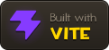
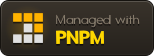
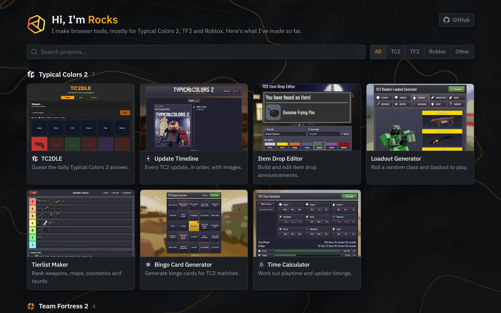

#  rhgx.github.io

The hub for my browser tools: Typical Colors 2, Team Fortress 2 and Roblox, plus a few other things.

**[Open the site](https://rhgx.github.io/)**

## What's on it

- A card for every live project, with a screenshot, grouped by game.
- Search across names, descriptions and keywords. It finds archived projects too.
- Category filters you can link to: `/#tc2`, `/#tf2`, `/#roblox` and `/#other`.
- An animated contour-map background that follows the scroll and bends around the mouse. With reduced motion on, it stays still.
- An [archive](https://rhgx.github.io/archives/) for my older projects. Their old links redirect there.

Most of my tools live in their own repositories, such as [Warpaint Viewer](https://github.com/Rhgx/warpaint-viewer). This one holds the hub and a few of my older pages.

## More

- [Running it locally, adding or archiving a project, and deploying](docs/development.md)
- [Icons, fonts and other credits](docs/credits.md)
- [The archive repository](https://github.com/Rhgx/archives)

## Credits

Made by me, Rocks. This is an unofficial fan site and isn't affiliated with Valve or Roblox Corporation. Game names, icons and trademarks belong to their owners; see [credits](docs/credits.md).
